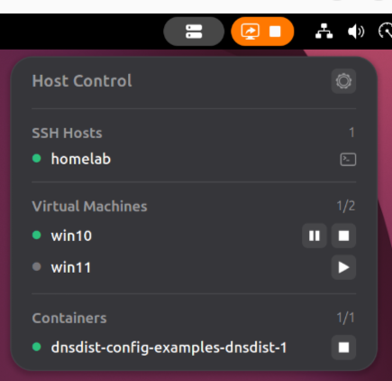

# hostctl

Minimalist QEMU/KVM virtual machine and container (Docker/Podman) controller for the GNOME Shell panel.



## Features

- Panel indicator for managing VMs, containers, and SSH hosts from one menu
- Lists QEMU/KVM virtual machines via `virsh list --all` (with `LC_ALL=C` / `LANG=C` for locale-safe parsing)
- Auto-detects `docker` and `podman` and lists containers via `ps -a`
- Lists `Host` entries from `~/.ssh/config` (ignoring wildcards) and opens `ssh <host>` in a terminal

## Requirements

- GNOME Shell `48`, `49`, `50`, or `51`
- `virsh` (`libvirt-clients` / `libvirt`) for QEMU/KVM VMs
- `docker` and/or `podman` for containers

## Installation

1. Run the install script:

   ```bash
   ./install.sh
   ```

2. Enable the extension (log out and back in first on Wayland if newly installed):

   ```bash
   gnome-extensions enable hostctl@dmachard.dev
   ```

## Testing

Run an isolated nested GNOME Shell session with the extension enabled:

```bash
./test-nested.sh
```

Requires `dbus-run-session` and `gnome-shell --devkit --wayland`.

## Build for website

Developers Guide: https://gjs.guide/extensions/

Update the version in `metadata.json`
Zip and upload at https://extensions.gnome.org/upload/

```bash
zip -r ~/hostctl@dmachard.dev.shell-extension.zip \
    extension.js \
    prefs.js \
    vmPanel.js \
    virshClient.js \
    containerClient.js \
    sshClient.js \
    exec.js \
    metadata.json \
    stylesheet.css \
    icons \
    schemas/org.gnome.shell.extensions.hostctl.gschema.xml
```

Before uploading, you can run the Shexli static analyzer locally to catch common packaging and review issues early.

```bash
virtualenv venv
. venv/bin/activate
pip install -U shexli
shexli ~/hostctl@dmachard.dev.shell-extension.zip
```
